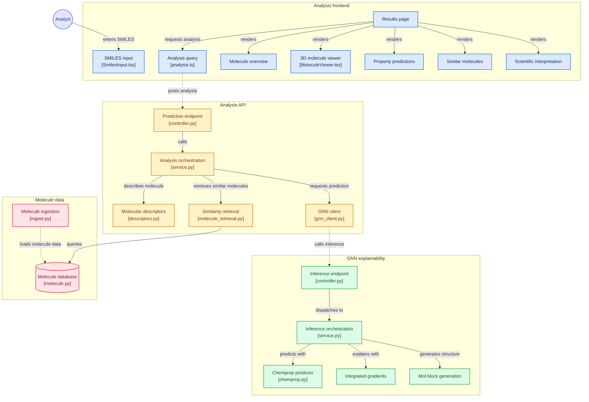

# AI Methods for Molecular Property Prediction

An end-to-end scientific platform for interactive molecular property prediction, atom-level explainability, and evidence-grounded interpretation. The system accepts chemical compounds in SMILES format and produces multi-task ADMET predictions for 18 endpoints, highlights the atoms driving each prediction, retrieves structural and semantic analogues using hybrid vector search, and grounds an LLM-written interpretation in published bioassay data.

Every model and method sits behind an interface and can be replaced; the choices currently in use are listed under [Current Implementation](#current-implementation).

Developed as an undergraduate Bachelor's thesis project.


## How to Run the Application

The application can be launched with Docker Compose or by running the services individually for local development.

### 1. Configure Environment Variables

Clone the repository and copy the environment configuration template:

```bash
git clone https://github.com/vuvanqh/AI-Methods-for-Molecular-Property-Prediction.git
cd AI-Methods-for-Molecular-Property-Prediction
cp .env.example .env
```

Set the OpenRouter API key in `.env` (Docker Compose refuses to start without it):
```env
OPENROUTER_API_KEY=your_openrouter_api_key_here
```

### 2. Launch with Docker Compose (Recommended)

Build and start all four containers:

```bash
docker compose up --build
```

#### Running Services & Access Points

| Service | Port | URL | Purpose |
|---|---|---|---|
| **Frontend Web UI** | `5173` | [http://localhost:5173](http://localhost:5173) | SMILES input, 3D attribution viewer, prediction cards |
| **Orchestrator API** | `8001` | [http://localhost:8001/api/docs](http://localhost:8001/api/docs) | FastAPI orchestrator for GNN coordination, RAG retrieval, and LLM summaries |
| **GNN & XAI Service** | `8000` | [http://localhost:8000/gnn-xai/docs](http://localhost:8000/gnn-xai/docs) | Isolated GNN predictor & XAI service |
| **PostgreSQL + pgvector** | `5433` | `127.0.0.1:5433` | Molecule corpus with structural fingerprints & learned molecular embeddings |

The database is mapped to host port `5433` so it does not collide with a local PostgreSQL on `5432`. All ports are bound to `127.0.0.1` only.

To shut down the platform:
```bash
docker compose down
```

---

### 3. Local Development Setup (Without Full Docker)

> `.env.example` ships with the Docker hostnames (`db:5432`, `gnn-xai:8000`). For local development, switch `DATABASE_URL` and `GNN_SERVICE_URL` in `.env` to the commented `127.0.0.1` variants.

#### Step 1: Start Database & pgvector
```bash
docker compose up db -d
```

#### Step 2: Apply Database Migrations
```bash
cd backend
uv run alembic upgrade head
cd ..
```

#### Step 3: Populate Reference Corpus (Optional but Recommended)
Fetch small molecules from the configured source, compute their fingerprints and learned embeddings, and load them into PostgreSQL (details in [docs/corpus-ingestion.md](docs/corpus-ingestion.md)):
```bash
uv run python -m scripts.ingestion.ingest
```

#### Step 4: Start GNN & XAI Microservice
```bash
cd backend/services/gnn_xai_service
uv sync
uv run uvicorn src.main:app --reload --port 8000
```

#### Step 5: Start Orchestrator API
```bash
cd backend/app
uv sync
uv run uvicorn src.main:app --reload --port 8001
```

#### Step 6: Start Frontend Development Server
```bash
cd frontend
npm install
npm run dev
```

For more detailed setup tips, environment variables, and troubleshooting, read the **[Getting Started & Run Guide](docs/getting-started.md)**.

---

## System Architecture

The frontend, the orchestrator API, and the GNN & XAI service communicate over HTTP; the orchestrator also queries PostgreSQL, the external evidence sources, and the LLM:




## Core Capabilities

### 1. Multi-Task Property Prediction (18 Targets)
A multi-task graph neural network outputs a probability and a binary prediction (per-task threshold) for 18 ADMET endpoints:
- **Tox21 Nuclear Receptor Signaling (7 pathways):** `NR-AR`, `NR-AR-LBD`, `NR-AhR`, `NR-Aromatase`, `NR-ER`, `NR-ER-LBD`, `NR-PPAR-gamma`
- **Tox21 Stress Response Pathways (5 pathways):** `SR-ARE`, `SR-ATAD5`, `SR-HSE`, `SR-MMP`, `SR-p53`
- **Cytochrome P450 Drug Metabolism (5 isozymes):** `CYP1A2`, `CYP2C9`, `CYP2C19`, `CYP2D6`, `CYP3A4`
- **Cardiotoxicity / Arrhythmia Risk (1 target):** `hERG_Karim` (human Ether-à-go-go-Related Gene potassium channel blockade, TDC benchmark by Karim et al.)

Training code and the MLflow setup live in [`experiments/gnn/`](experiments/gnn/README.md).

### 2. Explainable AI & Structural Attribution
- **Atom attribution:** an attribution method scores how much each atom contributes to each of the 18 predictions.
- **Conformer generation:** a 3D conformer of the molecule is generated and exported as a MolBlock, falling back to 2D coordinates when embedding fails.
- **Interactive 3D visualization:** the browser renders the structure in 3D and highlights the most strongly attributed atoms of the selected property.

### 3. Hybrid Similarity Retrieval
Finds similar compounds in the local corpus (PostgreSQL + `pgvector`) with interchangeable retrieval strategies:
- **Structural similarity** on molecular fingerprints.
- **Semantic similarity** on learned molecular embeddings.
- **Hybrid:** rank fusion of the structural and semantic candidate lists.

### 4. Grounded Scientific Evidence
- Instead of relying on the LLM's memory, the system fetches published experimental measurements at request time for the query compound and its nearest analogues. Each corpus molecule is queried at the databases it was ingested from.
- Measurement semantics are preserved: the relation (`=`, `>`, `<`) is kept, so "inactive up to" limits are not misread as measured values; values are compared on a standardized logarithmic potency scale ($-\log_{10}[\text{M}]$); each measurement keeps its publication (title, DOI, abstract).
- Measurements are ranked by potency, and the most potent one per target is passed to the prompt to support or question the predictions. Details in [docs/evidence-retrieval.md](docs/evidence-retrieval.md).

### 5. Literature-Grounded LLM Explanations
- The orchestrator combines the predictions, the top-attributed atom fragments (e.g. `N3 in CN`), and the retrieved evidence into a structured scientific prompt.
- A configurable LLM writes a short interpretation of the predictions that cites the retrieved measurements and similar molecules, so its claims can be checked against the sources.
- Failures degrade gracefully: if an evidence source or the LLM is unavailable, the predictions, 3D attributions, and similar compounds are still returned.

## Current Implementation

Each component can be swapped by adding a new implementation of its interface.

| Component | Interface | Current choice |
|---|---|---|
| Property predictor | `GNNPredictor` | Chemprop v2 multi-task D-MPNN |
| Attribution method | `XAIExplainer` | Captum Integrated Gradients (100 steps) |
| 3D conformer | — | RDKit ETKDGv3 |
| Structural fingerprint | — | Morgan, radius 2 (ECFP4), 2048 bits; Tanimoto similarity |
| Learned embedding | `BaseEmbeddings` | Uni-Mol v1 (512-d); cosine similarity |
| Retrieval strategy | `Retrieval` | hybrid: weighted reciprocal rank fusion (k = 60) |
| Evidence source | `ClientStrategyBase` | ChEMBL activities and documents (pChEMBL potencies) |
| Corpus source | `DataSource` | ChEMBL small molecules |
| LLM | `LLM_MODEL` setting | any OpenRouter model |

---

## Repository Structure

```
.
├── .github/                   # CI workflows, CodeQL, Dependency Review, Dependabot
├── backend/
│   ├── alembic/               # Database migration versions and env configuration
│   ├── alembic.ini            # Alembic configuration
│   ├── app/                   # FastAPI Orchestrator API
│   │   ├── src/               # Routes, retrieval, evidence and LLM clients, DB models
│   │   └── tests/             # Unit and e2e tests
│   └── services/
│       └── gnn_xai_service/   # GNN inference & XAI service
│           ├── src/           # Model loading, single-flight inference lock, MolBlocks
│           └── tests/         # Unit, integration, and e2e tests
├── docs/                      # Technical documentation
│   ├── getting-started.md     # Setup, configuration, and troubleshooting
│   ├── corpus-ingestion.md    # Corpus ingestion, standardization, fingerprints, embeddings
│   ├── database-design.md     # PostgreSQL schema, design decisions, ER diagram
│   ├── evidence-retrieval.md  # Bioassay evidence retrieval, potency ranking, prompt
│   ├── frontend-styling.md    # CSS token system, GSAP animation contracts, typography
│   ├── frontend-testing.md    # Vitest coverage rules, Playwright E2E suites
│   └── ci-cd-security.md      # GitHub Actions CI matrix, CodeQL, branch protection
├── experiments/
│   └── gnn/                   # Multi-task GNN training (TDC data, MLflow)
├── frontend/                  # React 19 + TypeScript + Vite frontend
│   ├── src/                   # Components, 3Dmol viewer, GSAP hooks, TanStack Query
│   ├── e2e/                   # Playwright E2E test suites
│   └── vite.config.ts         # Vite build configuration and Vitest test runner setup
├── scripts/
│   └── ingestion/             # Corpus ingestion
├── docker-compose.yml         # Multi-container orchestration (db, gnn-xai, api, frontend)
├── pyproject.toml             # Root uv project for scripts/ and Alembic
└── README.md
```

---

## Testing & Quality Assurance

### Frontend
- **Framework:** Vitest + React Testing Library + Playwright.
- **Coverage Enforcement:** CI fails below 80 % lines, statements, and functions or 75 % branches. The current suite is at about 99 % lines.
- **Commands:**
  ```bash
  cd frontend
  npm test                 # Interactive watch mode
  npm run test:coverage    # Coverage verification
  npm run test:e2e         # Playwright against a mocked API
  ```

### Backend
- **Framework:** pytest with `httpx` test clients and stubbed collaborators.
- **Commands:**
  ```bash
  # Test Orchestrator API
  cd backend/app && uv run pytest -v

  # Test GNN & XAI Service
  cd backend/services/gnn_xai_service && uv run pytest -v
  ```

### CI / CD & Security
- **CI:** GitHub Actions runs Ruff and pytest for each backend project (on its pinned Python version), frontend lint, coverage, and build on Node 24, and Playwright E2E tests.
- **CodeQL** analyzes Python and TypeScript on every push and pull request to `main` and weekly.
- **Dependency Review** blocks pull requests that add dependencies with known vulnerabilities of moderate severity or higher.
- **Dependabot** opens weekly version-update pull requests for GitHub Actions, npm, and pip.

---

## Documentation Index

For deep dives into design choices, mathematical foundations, and implementation details, refer to the documentation in [`docs/`](docs/):

- **[docs/getting-started.md](docs/getting-started.md)** — Running, configuring, and developing the application.
- **[docs/corpus-ingestion.md](docs/corpus-ingestion.md)** — Ingestion pipeline, standardization, fingerprints, and embeddings.
- **[docs/database-design.md](docs/database-design.md)** — Relational schema, design decisions, JSONB analysis snapshots, and the ER diagram.
- **[docs/evidence-retrieval.md](docs/evidence-retrieval.md)** — Scientific background on bioassays, potency normalization ($-\log_{10}[\text{M}]$), and evidence synthesis.
- **[docs/frontend-styling.md](docs/frontend-styling.md)** — Scientific dark UI design system, token definitions, and GSAP Flip layout transitions.
- **[docs/frontend-testing.md](docs/frontend-testing.md)** — Frontend testing philosophy, Vitest unit/integration tests, and Playwright E2E suites.
- **[docs/ci-cd-security.md](docs/ci-cd-security.md)** — Repository security baselines, CodeQL static analysis, and branch protection rules.
- **[backend/services/gnn_xai_service/README.md](backend/services/gnn_xai_service/README.md)** — Structure of the GNN & XAI service.
- **[experiments/gnn/README.md](experiments/gnn/README.md)** — GNN training.

---

## License

This project is licensed under the MIT License — see the [LICENSE](LICENSE) file for details.
