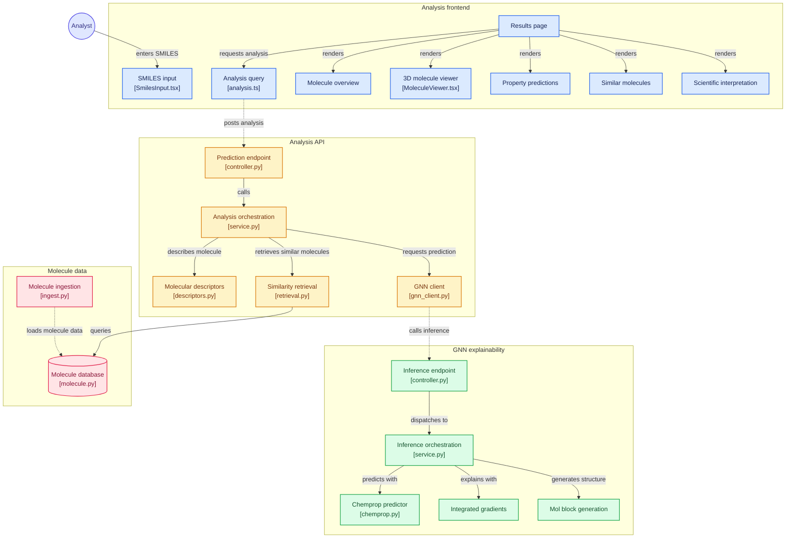

# AI Methods for Molecular Property Prediction

An end-to-end scientific platform for interactive molecular property prediction, atom-level explainability, and evidence-grounded interpretation. The system accepts chemical compounds in SMILES format and produces multi-task ADMET predictions across 18 critical biological endpoints, highlights pharmacophoric substructures using Integrated Gradients, retrieves structural and semantic analogues using hybrid vector search, and grounds results in published experimental bioassays from ChEMBL through an LLM synthesis engine.

Developed as an undergraduate Bachelor's thesis project.


## Quick Start: How to Run the Application

The application can be launched with Docker Compose or by running the services individually for local development.

### 1. Configure Environment Variables

Clone the repository and copy the environment configuration template:

```bash
git clone https://github.com/vuvanqh/AI-Methods-for-Molecular-Property-Prediction.git
cd AI-Methods-for-Molecular-Property-Prediction
cp .env.example .env
```

Provide your OpenRouter API key in `.env` to enable LLM-generated scientific summaries:
```env
OPENROUTER_API_KEY=your_openrouter_api_key_here
```

### 2. Launch with Docker Compose (Recommended)

Build and start all four microservices in detached mode:

```bash
docker compose up --build
```

#### Running Services & Access Points

| Service | Port | URL | Purpose |
|---|---|---|---|
| **Frontend Web UI** | `5173` | [http://localhost:5173](http://localhost:5173) | Interactive SMILES input, 3D conformer viewer, radar & prediction cards |
| **Orchestrator API** | `8001` | [http://localhost:8001/api/docs](http://localhost:8001/api/docs) | FastAPI orchestrator for GNN coordination, RAG retrieval, and LLM summaries |
| **GNN & XAI Service** | `8000` | [http://localhost:8000/gnn-xai/docs](http://localhost:8000/gnn-xai/docs) | Isolated Chemprop v2 GNN predictor & Captum Integrated Gradients service |
| **PostgreSQL + pgvector** | `5433` | `localhost:5433` | Vector database for Morgan fingerprints (bit(2048)) & Uni-Mol (512-d) vectors |

To shut down the platform:
```bash
docker compose down
```

---

### 3. Local Development Setup (Without Full Docker)

For active feature development with hot-reloading, run the PostgreSQL database via Docker and execute the microservices natively on your machine using [uv](https://docs.astral.sh/uv/) and **npm**.

#### Step 1: Start Database & pgvector
```bash
docker compose up db -d
```

#### Step 2: Apply Database Migrations
```bash
cd backend
uv run alembic upgrade head
cd ..
```

#### Step 3: Populate Reference Corpus (Optional but Recommended)
Ingest reference small molecules, compute 2048-bit Morgan fingerprints, and generate 512-dimensional Uni-Mol 3D representations from ChEMBL:
```bash
uv run python -m scripts.ingestion.ingest
```

#### Step 4: Start GNN & XAI Microservice
```bash
cd backend/services/gnn_xai_service
uv sync
uv run uvicorn src.main:app --reload --port 8000
```

#### Step 5: Start Orchestrator API
```bash
cd backend/app
uv sync
uv run uvicorn src.main:app --reload --port 8001
```

#### Step 6: Start Frontend Development Server
```bash
cd frontend
npm install
npm run dev
```

For more detailed setup tips, environment variables, and troubleshooting, read the **[Getting Started & Run Guide](docs/getting-started.md)**.

---

## System Architecture

The application is structured into decoupled microservices communicating over asynchronous HTTP and persistent PostgreSQL storage:




## Core Capabilities

### 1. Multi-Task GNN Property Prediction (18 Targets)
The platform predicts binary activity and calibrated probabilities across 18 critical ADMET endpoints:
- **Tox21 Nuclear Receptor Signaling (7 pathways):** `NR-AR`, `NR-AR-LBD`, `NR-AhR`, `NR-Aromatase`, `NR-ER`, `NR-ER-LBD`, `NR-PPAR-gamma`
- **Tox21 Stress Response Pathways (5 pathways):** `SR-ARE`, `SR-ATAD5`, `SR-HSE`, `SR-MMP`, `SR-p53`
- **Cytochrome P450 Drug Metabolism (5 isozymes):** `CYP1A2`, `CYP2C9`, `CYP2C19`, `CYP2D6`, `CYP3A4`
- **Cardiotoxicity / Arrhythmia Risk (1 target):** `hERG_Karim` (human Ether-à-go-go-Related Gene potassium channel blockade)

### 2. Explainable AI & Structural Attribution
- **Captum Integrated Gradients:** Runs 100 interpolation steps across atom feature embeddings in the Chemprop message-passing network to compute per-atom attribution scores for every active prediction.
- **Conformer Generation:** Computes low-energy 3D conformers using RDKit's ETKDGv3 and MMFF94 force field, exporting V2000 MolBlocks.
- **Interactive 3D Visualization:** Renders interactive 3D structures in the browser using `3Dmol.js`, coloring atoms along an attribution gradient to reveal toxicophores and functional binding pharmacophores.

### 3. Hybrid RAG Retrieval (Fingerprint + 3D Transformer)
Finds structurally and biologically similar compounds from the local corpus using PostgreSQL and `pgvector`:
- **Structural Similarity:** 2048-bit Morgan Fingerprints (radius 2 / ECFP4) indexed with bit-level Hamming/Tanimoto distances.
- **Semantic Similarity:** 512-dimensional Uni-Mol transformer embeddings trained on 3D molecular conformations.
- **Reciprocal Rank / Score Fusion:** Blends structural and semantic nearest neighbours to retrieve the most informative chemical analogues.

### 4. Grounded Scientific Evidence from ChEMBL
- Rather than predicting properties in isolation or trusting an LLM's ungrounded memory, the system fetches real experimental bioassays on-the-fly from ChEMBL for the query compound and its nearest analogues.
- Understands experimental assay metadata: handles concentration relations (`=`, `>`, `<`), standardizes units to nanomolar (`nM`), calculates logarithmic potencies ($-\log_{10}[\text{M}]$), and extracts publication DOIs and abstracts.
- Evaluates qualifying measurements (IC50, Ki, EC50, Kd, Potency) to substantiate or contextualize GNN predictions against real-world lab findings.

### 5. Literature-Grounded LLM Explanations
- The orchestrator synthesizes the GNN predictions, top-attributed atom fragments (e.g. `N3 in CN`), and retrieved bioassay evidence into a structured scientific prompt.
- An LLM (via OpenRouter) generates concise, verifiable paragraphs explaining the mechanistic basis for the predicted toxicity, citing specific published papers and measurements.
- Implements fault-tolerant degradation: network timeouts or LLM failures degrade smoothly without blocking prediction outputs.

---

## Repository Structure

```
.
├── .github/                   # CI/CD workflows, CodeQL scanning, dependabot
├── backend/
│   ├── alembic/               # Database migration versions and env configuration
│   ├── alembic.ini            # Alembic configuration
│   ├── app/                   # FastAPI Orchestrator API
│   │   ├── src/               # Routes, RAG retrieval engine, ChEMBL & LLM clients
│   │   └── tests/             # Unit and integration test suite
│   └── services/
│       └── gnn_xai_service/   # Chemprop v2 GNN inference & Captum XAI microservice
│           ├── src/           # Model loading, single-flight inference lock, MolBlocks
│           └── tests/         # Unit and e2e tests
├── docs/                      # Technical documentation and architecture specifications
│   ├── getting-started.md     # In-depth run, setup, and troubleshooting guide
│   ├── database-design.md     # PostgreSQL schema, pgvector indexes, ER diagram
│   ├── evidence-retrieval.md  # ChEMBL bioassay retrieval, potency ranking, RAG prompt
│   ├── frontend-styling.md    # CSS token system, GSAP animation contracts, typography
│   ├── frontend-testing.md    # Vitest coverage rules, Playwright E2E suites
│   └── ci-cd-security.md      # GitHub Actions CI matrix, CodeQL, branch protection
├── frontend/                  # React 19 + TypeScript + Vite frontend
│   ├── src/                   # Components, 3Dmol viewer, GSAP hooks, TanStack Query
│   ├── e2e/                   # Playwright E2E test suites
│   └── vite.config.ts         # Vite build configuration and Vitest test runner setup
├── scripts/
│   └── ingestion/             # Streaming ingestion from ChEMBL, RDKit standardization
├── docker-compose.yml         # Multi-container orchestration (db, gnn-xai, api, frontend)
├── pyproject.toml             # Python root configuration (uv workspace)
└── README.md
```

---

## Testing & Quality Assurance

The codebase enforces strict test coverage and static analysis across all tiers:

### Frontend
- **Framework:** Vitest + React Testing Library + Playwright.
- **Coverage Enforcement:** Mandatory $\ge 80\%$ line and function coverage, $\ge 75\%$ branch coverage. Current suite achieves $\sim 99\%$ line coverage.
- **Commands:**
  ```bash
  cd frontend
  npm test                 # Interactive watch mode
  npm run test:coverage    # Coverage verification
  npm run test:e2e         # Headless Playwright browser tests
  ```

### Backend & Microservices
- **Framework:** Pytest with asynchronous HTTP clients (`httpx`) and isolated service stubs.
- **Commands:**
  ```bash
  # Test Orchestrator API
  cd backend/app && uv run pytest -v

  # Test GNN & XAI Service
  cd backend/services/gnn_xai_service && uv run pytest -v
  ```

### CI / CD & Security
- **Automated Workflows:** GitHub Actions runs backend pytest suites on Python 3.11 and 3.12, frontend linting and tests on Node 20+, and CodeQL security analysis weekly.
- **Dependabot:** Weekly automated vulnerability tracking for Python, npm, and GitHub Actions dependencies.

---

## Documentation Index

For deep dives into design choices, mathematical foundations, and implementation details, refer to the documentation in [`docs/`](docs/):

- **[docs/getting-started.md](docs/getting-started.md)** — Comprehensive guide to running, configuring, and developing the application.
- **[docs/database-design.md](docs/database-design.md)** — Relational schema, pgvector vector indexing, JSONB experiment snapshots, and ER diagrams.
- **[docs/evidence-retrieval.md](docs/evidence-retrieval.md)** — Scientific background on bioassays, potency normalization ($-\log_{10}[\text{M}]$), and evidence synthesis.
- **[docs/frontend-styling.md](docs/frontend-styling.md)** — Scientific dark UI design system, token definitions, and GSAP Flip layout transitions.
- **[docs/frontend-testing.md](docs/frontend-testing.md)** — Frontend testing philosophy, Vitest unit/integration tests, and Playwright E2E suites.
- **[docs/ci-cd-security.md](docs/ci-cd-security.md)** — Repository security baselines, CodeQL static analysis, and branch protection rules.
- **[backend/services/gnn_xai_service/README.md](backend/services/gnn_xai_service/README.md)** — Chemprop v2 GNN architecture and Captum Integrated Gradients service.

---

## License

This project is licensed under the MIT License — see the [LICENSE](LICENSE) file for details.
