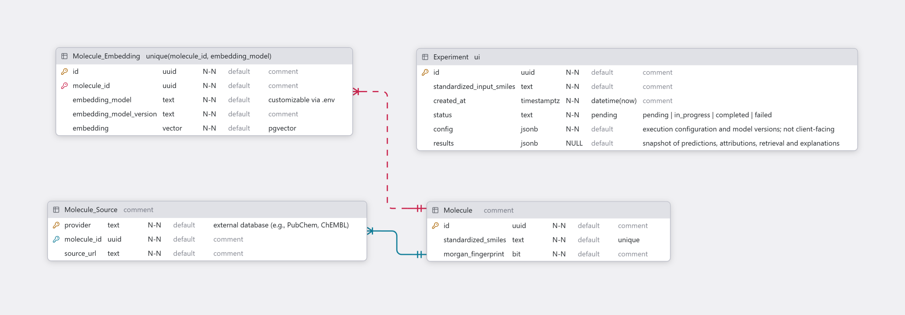

# Database Design

## Overview
The document describes the database schema for the Molecular Property Analysis system, including its entities, relationships, constraints, and design choices.

The system uses PostgreSQL with pgvector extension to support similarity-based retrieval. The schema only considers the scope of the MVP, and will evolve as the application progresses.

## Entity-Relationship Diagram

## Entity Descriptions

All primary keys are assumed to be not null.

### Molecule (`molecules`)

Represents a molecule from the retrieval corpus. Each molecule is identified by a unique surrogate identifier.

| property | type | constraints | description |
|--------|----|-----------|-----------|
| id | uuid | PK | internal molecule id |
| standardized_smiles | text | unique, not null | canonical isomeric SMILES generated by RDKit after `rdMolStandardize.Cleanup` (salts and solvents are kept) |
| morgan_fingerprint | bit(2048) | not null | 2048-bit Morgan fingerprint (radius 2, equivalent to ECFP4) used for structural similarity search |

### Molecule Source (`molecule_sources`)

Represents the references to the external databases, allowing the system to retrieve scientific evidence without having to store and maintain it within the local corpus.

| property | type | constraints | description |
|--------|----|-----------|-----------|
| provider | text | composite PK | external data provider e.g., PubChem or ChEMBL | 
| molecule_id | uuid | composite PK, FK | references the corresponding molecule | 
| source_identifier | text | not null | identifier of the molecule within the provider, e.g., ChEMBL ID `CHEMBL25`; combined with the provider's API base URL to retrieve external information |

Storing the provider's identifier instead of a full URL keeps the corpus valid when a provider changes its API URLs or versions; the URL is built at request time.

The composite primary key (provider, molecule_id) restricts the molecules to have one reference per provider, at the same time allowing them to have multiple sources from different providers.

### Molecule Embedding (`molecule_embeddings`)

Represents a learned embedding generated by encoder models. The entity supports incremental implementation. A new embedding representation has to be generated every time an embedding model is fine-tuned or replaced. Having a separate entity allows us to substitute the molecules' embeddings without a need to update the whole molecule table each time.

| property | type | constraints | description |
|--------|----|-----------|-----------|
| id | uuid | PK | internal embedding identifier |
| molecule_id | uuid | FK, not null | references the corresponding molecule | 
| embedding_model | text | not null | embedding model architecture identifier e.g., Unimol or ChemBERTa |
| embedding_model_version | text | not null | identifier for a specific pretrained or fine-tuned checkpoint | 
| embedding | vector | not null | molecular embedding generated by a specified model version |

A unique constraint on (molecule_id, embedding_model, embedding_model_version) prevents storing multiple representations of the same molecule under the same encoder configuration.

### Analysis (`analyses`)

Represents an individual molecular analysis (experiment) initiated by a researcher. Each analysis stores input, execution metadata, experimental configuration setup, and results.

| property | type | constraints | description |
|--------|----|-----------|-----------|
| id | uuid | PK | internal experiment identifier | 
| standardized_input_smiles | text | not null | SMILES input submitted in the experiment request | 
| created_at | timestamptz | not null | timestamp of when the experiment was started | 
| status | enum (`analysis_status_enum`) | not null | execution status: Pending, In Progress, Completed, Failed |
| config | jsonb | not null | snapshot of inference configuration, model versions, and retrieval settings | 
| results | jsonb | null | snapshot of predictions, structural attributions, retrieved molecules, scientific evidence, and generated explanations |

As users are allowed to input a SMILES format of not-yet-discovered molecules, we do not establish any relationship between the Analysis and Molecule tables, especially since input is already stored.

## Relationships and Constraints

| relationship | Cardinality | description |
|------------|----------|-----------|
| *Molecule* - *Molecule Source* | 1 to n | A single molecule can reference multiple external data providers |
| *Molecule* - *Molecule Embedding* | 1 to n | A molecule may have learned embeddings produced by different encoder versions or different encoder models |

Referential integrity is maintained through foreign key constraints. 

## Design Decisions

### Molecular Representation and Hybrid Retrieval

Morgan fingerprints are stored directly in the *Molecule*, and serve as a baseline for structural similarity retrieval.

Learned representations are maintained separately in *Molecule Embedding*, allowing the initial fingerprint-only implementation to be extended with embedding-based retrieval. This also allows us to replace the fingerprint retrieval with embedding retrieval or to combine the two approaches, without having to update the whole *Molecule* table each time we change the embedding encoder or encoder version after fine-tuning.

The hybrid retrieval combines structural and embedding-based similarity through weighted reciprocal rank fusion of both candidate lists. Both representations are searched using *PostgreSQL* extended by *pgvector*.

### External Scientific Retrieval

Scientific evidence is retrieved on demand from external databases using the persisted *provider* and *source_identifier* from *Molecule Source* table, rather than permanently stored in the application corpus.

The design accepts the trade-off of reducing storage requirements, ingestion complexity, and maintenance overhead, at the cost of increased network latency and dependence on external API availability.

### JSONB Snapshot Model

The *Analysis* table uses JSONB to store execution configuration and results. Each row represents a single molecular analysis and its results form a snapshot of the predictions, explanations, retrieval outputs, and supporting evidence generated during execution.

The snapshot design was selected for three principal reasons:
- Schema Flexibility: Predicted ADMET endpoints, explainability outputs, and retrieval strategies may evolve during development without requiring frequent relational schema changes.
- Consistency: An analysis preserves the outputs and configuration associated with a specific execution, supporting historical interpretation even when the deployed models change.
- Reduced Relational Complexity: The MVP primarily retrieves complete analysis results rather than querying individual predictions or attributions independently. Separate relational entities are therefore unnecessary.

The snapshot preserves the relevant scientific evidence used to generate explanations, including source references and retrieved values, rather than relying only on external URLs.

JSONB structures include a schema version and are validated by the application to maintain consistency.